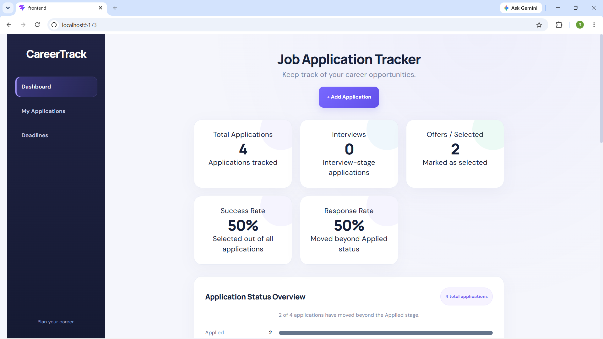

# CareerTrack – Job Application Tracker

CareerTrack is a full-stack web application that helps users organize and track their job applications in one place.

It provides a dashboard to monitor application progress, manage application details, search and filter opportunities, and keep track of important deadlines.

## Features

- **Dashboard:** View job application statistics and application status summaries.
- **Application Management:** Add, edit, and delete job applications.
- **Status Tracking:** Track applications through Applied, Assessment, Interview, Selected, and Rejected statuses.
- **Search Applications:** Find applications using the available search functionality.
- **Filter Applications:** Filter applications according to their status.
- **Deadline Tracking:** View upcoming and overdue application deadlines.
- **Persistent Storage:** Store application records using the FastAPI backend and a local JSON file.
- **REST API:** Manage application records through FastAPI endpoints.
- **Responsive Interface:** Use a dashboard-style interface built with React and CSS.

## Technologies Used

### Frontend
- React
- JavaScript
- HTML
- CSS
- Vite

### Backend
- Python
- FastAPI
- Pydantic
- Uvicorn

### Data Storage
- JSON file-based storage

### Development Tools
- Visual Studio Code
- Git
- GitHub
- npm

## Project Structure

```text
CareerTrack-Job-Application-Tracker/
├── backend/
│   └── main.py
├── frontend/
│   ├── public/
│   ├── src/
│   │   ├── assets/
│   │   ├── App.jsx
│   │   ├── App.css
│   │   ├── index.css
│   │   └── main.jsx
│   ├── package.json
│   └── vite.config.js
├── .gitignore
└── README.md
---

## 📸 Application Screenshots

### Dashboard

